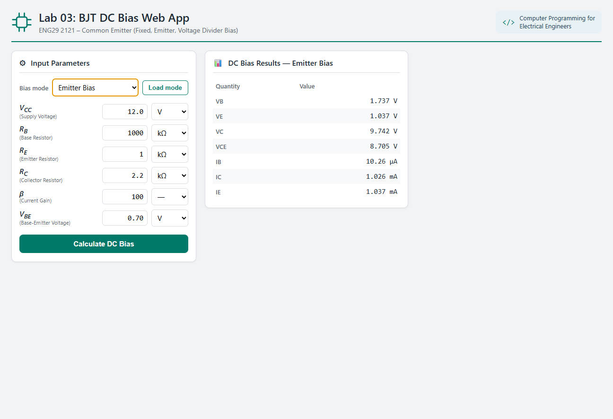

# Lab 03 — Browser Validation (A1–A5)

- **Method:** OpenCode Browser (in-app Chromium, allowed fallback in the Lab 03 sheet)
- **App URL:** http://127.0.0.1:5000
- **Code under test:** commit `a670469` (`feat: add bias mode selector and per-mode forms`)
- **Run command:** `.venv\Scripts\python -m bjt_ce_bias.app`
- **Test command:** `.venv\Scripts\python -m unittest discover -s bjt_ce_bias/tests -t . -v` → 37 tests OK
- **Tolerance:** IC ±0.01 mA, VCE ±0.02 V (display rounds IC to 0.001 mA and VCE to 0.001 V)

Shared inputs unless stated: VCC = 12 V, RC = 2.2 kΩ, β = 100, VBE = 0.70 V.

## Results

| ID | Mode / inputs | Expected IC (mA) | Expected VCE (V) | Observed IC (mA) | Observed VCE (V) | Units | Status |
|----|---------------|------------------|------------------|------------------|------------------|-------|--------|
| A1 | Voltage Divider, R1 = 100 kΩ, R2 = 22 kΩ, RE = 1 kΩ | 1.2299 | 8.0522 | 1.230 | 8.052 | mA / V | PASS |
| A2 | Fixed, RB = 1000 kΩ (no RE field) | 1.1300 | 9.5140 | 1.130 | 9.514 | mA / V | PASS |
| A3 | Emitter, RB = 1000 kΩ, RE = 1 kΩ | 1.0263 | 8.7055 | 1.026 | 8.705 | mA / V | PASS |
| A4 | Emitter, RB = 1000 kΩ, RE = 2 kΩ | 0.9401 | 8.0328 | 0.940 | 8.033 | mA / V | PASS |
| A5 | Fixed, RB = 0 kΩ | — | — | field error | field error | — | PASS |

A5 detail: the page showed `RB: RB must be greater than 0 Ω`, kept the typed
`RB = 0`, rendered no results table, and the page stayed alive. No stale A2
results were shown.

A3 → A4 direction: raising RE from 1 kΩ to 2 kΩ reduced IC from 1.026 mA to
0.940 mA and raised VE from 1.037 V to 1.899 V, as the emitter-bias equation
predicts.

## Full observed values

| ID | VB (V) | VE (V) | VC (V) | VCE (V) | IB (µA) | IC (mA) | IE (mA) |
|----|--------|--------|--------|---------|---------|---------|---------|
| A1 | 1.942 | 1.242 | 9.294 | 8.052 | 12.30 | 1.230 | 1.242 |
| A2 | 0.700 | 0.000 | 9.514 | 9.514 | 11.30 | 1.130 | 1.141 |
| A3 | 1.737 | 1.037 | 9.742 | 8.705 | 10.26 | 1.026 | 1.037 |
| A4 | 2.599 | 1.899 | 9.932 | 8.033 | 9.40 | 0.940 | 0.950 |

A1 also showed the `Active region` badge and the independent nodal check; the
displayed values match the pinned Lab 02 values (IC 1.229858 mA, VCE 8.052155 V).

## Independent expected values

These were derived by hand from the Lab 03 equations, not copied from the app.

- **A1 (divider).**
  `VTH = 12 × 22/(100+22) = 2.163934 V`;
  `RTH = 100×22/(100+22) = 18.03279 kΩ`.
  `IB = (2.163934 − 0.70)/(18.03279 + 101×1) = 1.463934/119.03279 = 0.0122986 mA`.
  `IC = 1.22986 mA`; `IE = 1.24216 mA`; `VE = 1.24216 V`;
  `VB = 1.94216 V`; `VC = 12 − 1.22986×2.2 = 9.29431 V`;
  `VCE = 8.05216 V`.
- **A2 (fixed).**
  `IB = (12 − 0.70)/1000 kΩ = 0.01130 mA`; `IC = 1.1300 mA`;
  `IE = 1.1413 mA`; `VE = 0 V`; `VB = 0.700 V`;
  `VC = 12 − 1.1300×2.2 = 9.5140 V`; `VCE = 9.5140 V`.
- **A3 (emitter, RE = 1 kΩ).**
  `IB = (12 − 0.70)/(1000 + 101×1) = 11.3/1101 = 0.0102634 mA`;
  `IC = 1.02634 mA`; `IE = 1.03660 mA`; `VE = 1.03660 V`;
  `VB = 1.73660 V`; `VC = 12 − 1.02634×2.2 = 9.74205 V`;
  `VCE = 8.70545 V`.
- **A4 (emitter, RE = 2 kΩ).**
  `IB = 11.3/(1000 + 101×2) = 11.3/1202 = 0.0094010 mA`;
  `IC = 0.94010 mA`; `IE = 0.94950 mA`; `VE = 1.89900 V`;
  `VB = 2.59900 V`; `VC = 12 − 0.94010×2.2 = 9.93178 V`;
  `VCE = 8.03278 V`.
- **A5 (fixed, RB = 0).** The parser rejects `RB ≤ 0` before any solve, so no
  expected operating point exists.

## Evidence

## AI assistance and student checks

- **AI-generated:** the Flask/Jinja implementation, the Lab 03 plan and this
  validation document, the scripted test-client checks, and the browser run
  recorded above. The equations were taken from the Lab 03 sheet
  (`ENG29_2121_Lab03_BJT_Bias_Web_App.html`).
- **Student checks required before submission:** read the three sets of
  equations against the Lab 03 sheet, run the test command above, repeat the
  A1–A5 inputs in the browser, and confirm the observed values and screenshot
  match this document. The student should be able to explain each equation and
  why `RB = 0` is rejected.
